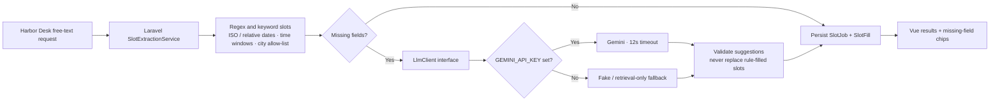

# Slot Fill Desk

Slot Fill Desk is a small Laravel + Vue intake workspace for Harbor Desk. Paste a plain-language pickup or delivery request and it extracts three booking fields: **date**, **time window**, and **city**. Any field it cannot safely fill stays visible as a missing chip for a person to review.

## AI design

Deterministic extractors handle known patterns first: ISO dates and relative `today` / `tomorrow`, morning / afternoon / evening keywords, and a small city allow-list. The optional `LlmClient` interface is called only with the leftover field names. Gemini suggestions cannot overwrite deterministic values, and invalid or unavailable model responses fall back to the extracted values plus missing fields. Requests have a 12-second HTTP timeout.



The code path is `SlotJobController` → `SlotExtractionService` → `LlmClient`. Production selects `GeminiLlmClient` only when `GEMINI_API_KEY` is present; otherwise it binds `FakeLlmClient`, which leaves any unresolved field for human review. The same fake is explicitly bound in the feature tests.

## Run locally without an API key

Requirements: PHP 8.3+, Composer, Node 22+, and npm.

```bash
composer setup
php artisan db:seed
composer run dev
```

Open the local URL reported by the development server. The setup uses SQLite and does not need Redis, external services, or a Gemini key. The seeded examples demonstrate a complete request and one request with a date still missing. To enable optional Gemini extraction, add `GEMINI_API_KEY` to `.env` and restart the app.

## Tests

```bash
composer test
```

The Pest feature tests POST as a guest and assert the request returns successfully, `pickup tomorrow afternoon in Miami` resolves to its date, `afternoon`, and `Miami`, the bound fake is not called when deterministic extraction is complete, the fake receives only unresolved fields when needed, deterministic fields cannot be overwritten by a model suggestion, and a model exception still returns a reviewable result instead of a 500.

## Data model

- `SlotJob`: original `source_text` and processing `status`.
- `SlotFill`: one fill per job with nullable `date`, `window`, and `city`, plus a JSON `missing` list.

The demo uses fictional booking requests only. Do not paste real addresses or sensitive customer information.
